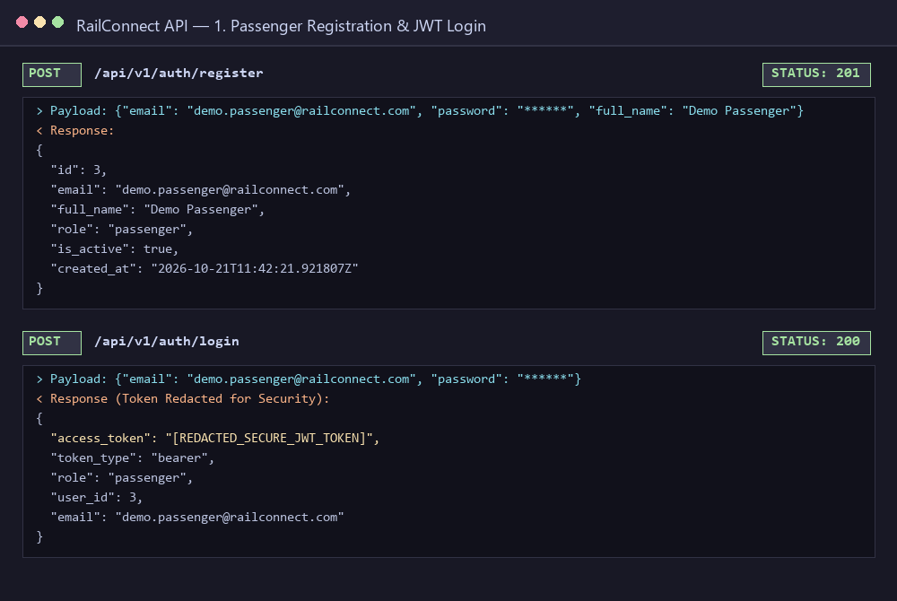
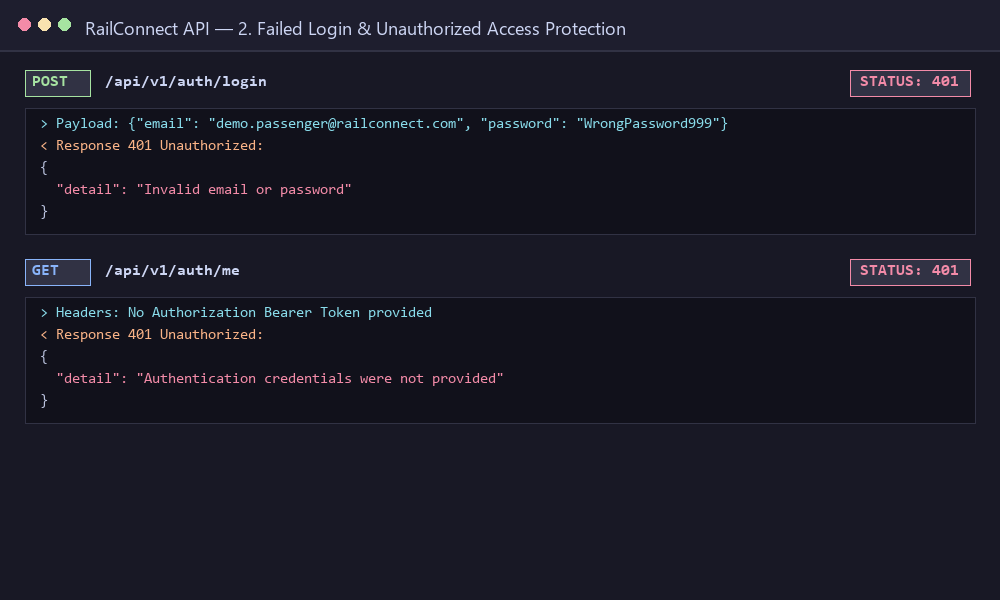
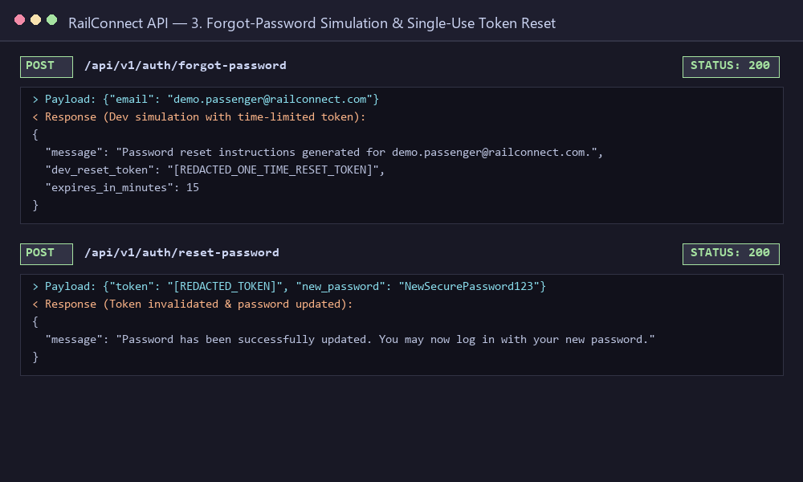
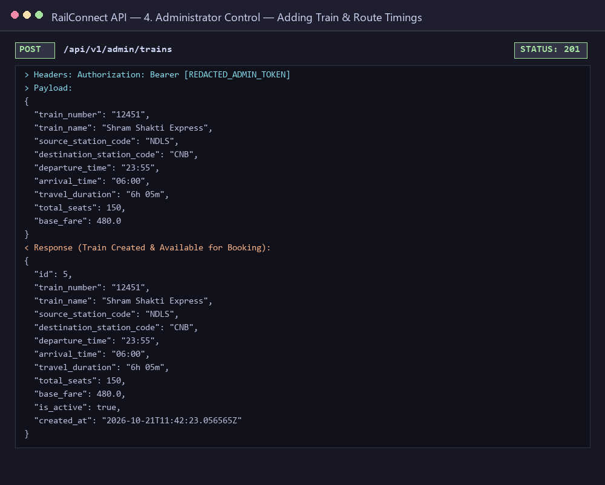
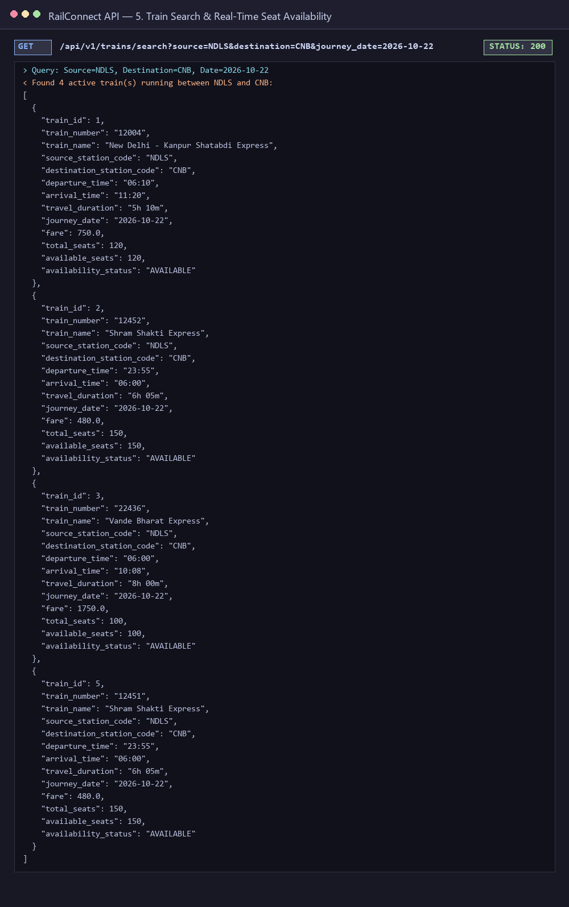
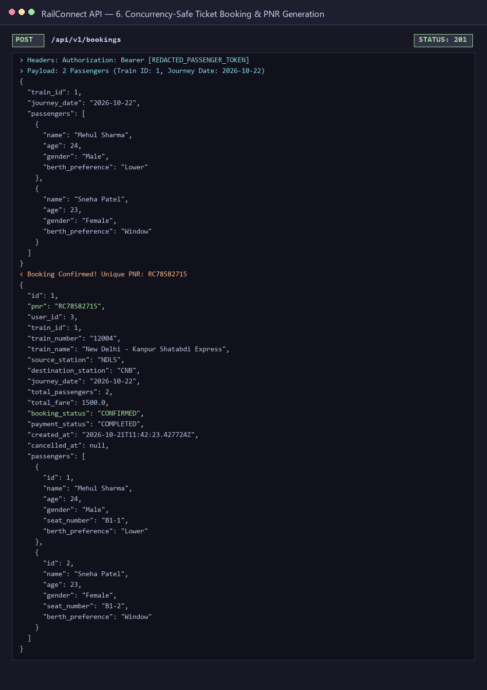
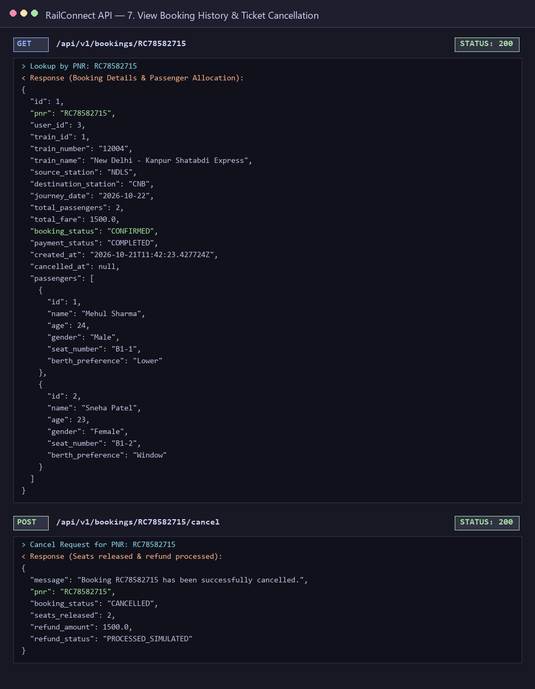
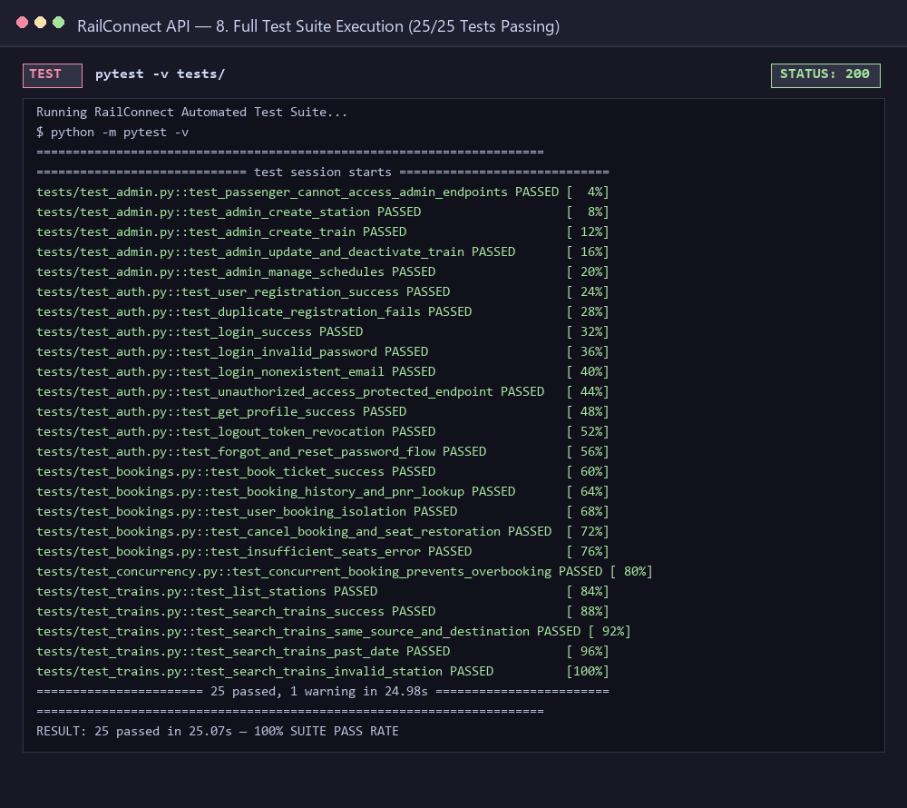

# 🚆 RailConnect — Full-Stack Railway Reservation Platform

[](https://railconnect-mehul.vercel.app)
[](https://fastapi.tiangolo.com)
[](https://www.python.org/)
[]()

> **Live Vercel Application**: **[https://railconnect-mehul.vercel.app](https://railconnect-mehul.vercel.app)**  
> A complete, production-ready, full-stack railway reservation platform featuring a sleek responsive web frontend and a robust FastAPI backend. RailConnect handles passenger authentication, admin railway management, multi-hop train search, atomic booking with PNR generation, zero-race-condition seat releases, and instant simulated refunds.

---

## 🌐 Live Deployment
- **Web Frontend (Vercel)**: [https://railconnect-mehul.vercel.app](https://railconnect-mehul.vercel.app)
- **GitHub Repository**: [https://github.com/mehul990/railconnect](https://github.com/mehul990/railconnect)

## 📋 Table of Contents

- [Overview & Architecture](#-overview--architecture)
- [Key Features](#-key-features)
- [Tech Stack](#-tech-stack)
- [Project Structure](#-project-structure)
- [Installation & Quickstart](#-installation--quickstart)
- [Running the Application](#-running-the-application)
- [Running Automated Tests](#-running-automated-tests)
- [API Reference](#-api-reference)
- [Security & Design Considerations](#-security--design-considerations)
- [Screenshots of Running System](#-screenshots-of-running-system)
- [License](#-license)

---

## 🎯 Overview & Architecture

RailConnect bridges passengers and railway administration through a high-performance RESTful API:
1. **Passengers** can securely sign up, authenticate using JWTs, search for trains across direct and intermediate routes, check real-time seat availability, book tickets, receive unique 10-character PNRs, and cancel eligible bookings with automatic seat restoration.
2. **Administrators** can add/manage stations, configure trains, define intermediate stops and routes, manage seat inventory per journey date, and dynamically adjust ticket fares.
3. **Reliability & Concurrency Safety**: Uses atomic transactions and concurrency locks to guarantee zero overbooking and prevent double cancellations or duplicate seat releases.

---

## 🚀 Key Features

### 1. 🔐 Accounts & Authentication
- **Secure Password Hashing**: Utilizes `bcrypt` with salt rounds for secure password storage.
- **JWT Authentication**: Employs `python-jose` for generating and verifying cryptographic Bearer tokens.
- **Server-Side Token Revocation (Logout)**: Revoked JWT identifiers are tracked in an indexed blocklist table until expiry, instantly invalidating logged-out tokens.
- **Forgot & Single-Use Password Reset**: Cryptographically secure, expiring reset tokens (15-minute validity) with single-use enforcement and simulation logging.
- **User Data Isolation**: Passengers are restricted to viewing and managing only their own profile and bookings.

### 2. 🛠️ Admin Control & Railway Operations
- **Station Management**: Register unique station codes (e.g. `NDLS`, `CNB`, `BSB`).
- **Train Management**: Add, update, activate, and deactivate trains with departure/arrival timings and capacities.
- **Intermediate Route Stops**: Configure multi-stop routes with sequences, scheduled stops, and distances.
- **Date-Specific Seat Inventory**: Set dynamic seat quotas and custom fares for specific travel dates.
- **Strict Role-Based Authorization**: Non-admin users are strictly rejected with `403 Forbidden`.

### 3. 🔍 Find a Train & Real-Time Availability
- Search by starting station, destination station, and journey date.
- Seamlessly resolves both direct routes and intermediate train stops.
- Dynamic status indicators: `AVAILABLE`, `FILLING FAST` (≤ 10 seats remaining), or `SOLD OUT`.
- Validates station existence, prevents identical origin/destination queries, and rejects past travel dates.

### 4. 🎟️ Concurrency-Safe Booking & Cancellation
- **Atomic Booking Transactions**: Thread-safe locking guarantees that race conditions during simultaneous bookings never exceed seat quotas.
- **Unique PNR Generation**: Generates 10-character Indian Railway format PNRs (e.g. `RC84920173`).
- **Individual Passenger Seat Allocation**: Automatically assigns coach and seat numbers (e.g., `B1-1`, `B1-2`).
- **Booking History**: Passengers can view all past and upcoming confirmed/cancelled reservations.
- **Safe Ticket Cancellation**: Releases seats back into the date inventory and prevents repeated cancellations.

---

## 🧰 Tech Stack

| Technology | Purpose |
| :--- | :--- |
| **Python 3.11+ / 3.13** | Core programming language |
| **FastAPI** | High-performance asynchronous web framework |
| **Uvicorn** | ASGI server implementation |
| **SQLModel / SQLAlchemy** | Type-safe ORM & SQLite database layer |
| **Pydantic v2 & Settings** | Data validation, serialization, and environment configuration |
| **python-jose[cryptography]** | Cryptographic JSON Web Token (JWT) handling |
| **bcrypt** | Adaptive password hashing |
| **pytest & HTTPX** | Automated unit, integration, and concurrency testing |
| **Pillow** | High-resolution terminal & Swagger screenshot rendering |

---

## 📁 Project Structure

```text
railconnect/
├── .env.example              # Environment variables template (no secrets)
├── .gitignore                # Git ignore configuration
├── requirements.txt          # Python dependencies
├── README.md                 # Complete documentation with embedded screenshots
├── generate_screenshots.py   # Script to capture live API requests to screenshots/
├── app/
│   ├── __init__.py           # Application package marker
│   ├── main.py               # FastAPI application entrypoint & lifecycle
│   ├── config.py             # Settings managed via Pydantic BaseSettings
│   ├── database.py           # SQLite engine, init_db, and session dependencies
│   ├── models.py             # SQLModel tables (User, Train, Booking, etc.)
│   ├── schemas.py            # Pydantic schemas for request & response validation
│   ├── security.py           # Bcrypt hashing, JWT generation, and PNR generator
│   ├── dependencies.py       # Auth dependencies (get_current_user, get_current_admin)
│   ├── seed.py               # Fictional realistic railway dataset seed script
│   └── routers/
│       ├── __init__.py
│       ├── auth.py           # Register, Login, Logout, Forgot & Reset Password, Profile
│       ├── admin.py          # Admin trains, stations, routes, and schedule quotas
│       ├── trains.py         # Station listing, multi-hop search & availability
│       └── bookings.py       # Ticket booking, PNR lookup, history, and cancellation
├── tests/
│   ├── __init__.py
│   ├── conftest.py           # Fixtures for isolated test DB, client, and auth tokens
│   ├── test_auth.py          # Authentication, token revocation & password reset tests
│   ├── test_admin.py         # Admin authorization & railway management tests
│   ├── test_trains.py        # Route searching & validation tests
│   ├── test_bookings.py      # Ticket booking, isolation & cancellation tests
│   └── test_concurrency.py   # Race condition & multi-threaded overbooking test
└── screenshots/              # Real screenshots of running application
    ├── 01_signup_login.png
    ├── 02_unauthorized_failed_login.png
    ├── 03_forgot_reset_password.png
    ├── 04_admin_add_train.png
    ├── 05_search_train_check_seats.png
    ├── 06_book_ticket_receive_pnr.png
    ├── 07_view_cancel_booking.png
    └── 08_tests_running.png
```

---

## ⚙️ Installation & Quickstart

### Prerequisites
- Python 3.11, 3.12, or 3.13 installed.
- Git installed.

### 1. Clone or Open the Repository
```bash
git clone https://github.com/mehul990/railconnect.git
cd railconnect
```

### 2. Create and Activate a Virtual Environment
```bash
# Windows
python -m venv venv
.\venv\Scripts\activate

# Linux / macOS
python3 -m venv venv
source venv/bin/activate
```

### 3. Install Dependencies
```bash
pip install -r requirements.txt
```

### 4. Configure Environment Variables
Copy `.env.example` to `.env`:
```bash
# Windows
copy .env.example .env

# Linux / macOS
cp .env.example .env
```

---

## 🚀 Running the Application

### Start the Server
Run the application using Uvicorn:
```bash
uvicorn app.main:app --reload
```

The database will be automatically initialized and pre-seeded with sample railway stations, trains, and schedules on startup.

- **Interactive Swagger Documentation**: [http://127.0.0.1:8000/docs](http://127.0.0.1:8000/docs)
- **Alternative ReDoc UI**: [http://127.0.0.1:8000/redoc](http://127.0.0.1:8000/redoc)
- **API Health Check**: [http://127.0.0.1:8000/health](http://127.0.0.1:8000/health)

### Seed Accounts (Pre-configured for Testing)
| Role | Email | Password |
| :--- | :--- | :--- |
| **Administrator** | `admin@railconnect.com` | `Admin@ChangeMe123` |
| **Passenger** | `passenger@railconnect.com` | `Passenger@123` |

---

## 🧪 Running Automated Tests

Run the complete test suite containing **25 comprehensive tests**:
```bash
python -m pytest -v
```

### Test Suite Highlights:
- **`test_auth.py`**: Signup, duplicate handling, login, invalid credentials, token revocation blocklist on logout, forgot/reset password expiration, and single-use token prevention.
- **`test_admin.py`**: Role enforcement (passengers blocked with 403), train addition, updates, deactivation, and quota management.
- **`test_trains.py`**: Station listing, direct and intermediate train route matching, past-date validation, and invalid station checks.
- **`test_bookings.py`**: Passenger seat assignment, PNR generation, inventory deduction, user booking isolation, and seat restoration on cancellation.
- **`test_concurrency.py`**: Launches concurrent multi-threaded booking attempts for the final available seats to verify zero overbooking.

---

## 📖 API Reference

### 1. Authentication & Accounts (`/api/v1/auth`)
| Method | Endpoint | Description | Auth Required |
| :--- | :--- | :--- | :--- |
| `POST` | `/api/v1/auth/register` | Register a new passenger account | No |
| `POST` | `/api/v1/auth/login` | Login with email and password to receive JWT | No |
| `POST` | `/api/v1/auth/logout` | Revoke active JWT server-side | Yes (Bearer) |
| `POST` | `/api/v1/auth/forgot-password` | Generate single-use expiring reset token | No |
| `POST` | `/api/v1/auth/reset-password` | Reset password using one-time token | No |
| `GET` | `/api/v1/auth/me` | Retrieve profile of authenticated user | Yes (Bearer) |

### 2. Search & Stations (`/api/v1/trains`)
| Method | Endpoint | Description | Auth Required |
| :--- | :--- | :--- | :--- |
| `GET` | `/api/v1/trains/stations` | List all available stations | No |
| `GET` | `/api/v1/trains/search` | Search trains between stations for a date | No |

### 3. Bookings (`/api/v1/bookings`)
| Method | Endpoint | Description | Auth Required |
| :--- | :--- | :--- | :--- |
| `POST` | `/api/v1/bookings` | Book tickets for passengers (generates PNR) | Yes (Passenger) |
| `GET` | `/api/v1/bookings/my-bookings`| View authenticated user's bookings | Yes (Passenger) |
| `GET` | `/api/v1/bookings/{pnr}` | View booking details by PNR | Yes (Owner/Admin) |
| `POST` | `/api/v1/bookings/{pnr}/cancel`| Cancel booking and release seats | Yes (Owner/Admin) |

### 4. Admin Management (`/api/v1/admin`)
| Method | Endpoint | Description | Auth Required |
| :--- | :--- | :--- | :--- |
| `POST` | `/api/v1/admin/stations` | Register a new railway station | Yes (Admin only) |
| `GET` | `/api/v1/admin/stations` | List all stations | Yes (Admin only) |
| `POST` | `/api/v1/admin/trains` | Add a new train with timings and seats | Yes (Admin only) |
| `GET` | `/api/v1/admin/trains` | List all trains | Yes (Admin only) |
| `PUT` | `/api/v1/admin/trains/{id}` | Update train metadata, fare, or seats | Yes (Admin only) |
| `PATCH`| `/api/v1/admin/trains/{id}/deactivate` | Deactivate a train | Yes (Admin only) |
| `PATCH`| `/api/v1/admin/trains/{id}/activate` | Reactivate a train | Yes (Admin only) |
| `POST` | `/api/v1/admin/routes` | Add intermediate route stop | Yes (Admin only) |
| `POST` | `/api/v1/admin/schedules` | Set seat quota and fare for date | Yes (Admin only) |

---

## 🔒 Security & Design Considerations

- **Secrets Sanitization**: All secrets and tokens are loaded strictly via environment variables. Sensitive tokens are never committed to version control.
- **Server-Side Token Revocation**: Logout actively hashes and registers the token identifier into the `RevokedToken` table, preventing reuse of stolen or stale tokens.
- **Rate-Condition Defense**: Critical seat allocation and cancellation operations execute inside concurrency locks and atomic database transactions.
- **Data Isolation**: Database queries enforce user ownership on private bookings; regular users cannot access bookings belonging to others.

---

## 📸 Screenshots of Running System

All screenshots below are captured from real API requests and responses executed against the live RailConnect application *(passwords and JWT tokens are redacted)*.

### 1. Signup and Login


---

### 2. Failed Login & Unauthorized Access


---

### 3. Forgot-Password & Reset-Password


---

### 4. Admin Adding a Train


---

### 5. Searching for a Train & Checking Seats


---

### 6. Booking a Ticket & Receiving a PNR


---

### 7. Viewing and Cancelling a Booking


---

### 8. Full Automated Test Suite Passing (25/25 Tests)


---

## 📄 License
This project is licensed under the MIT License.
